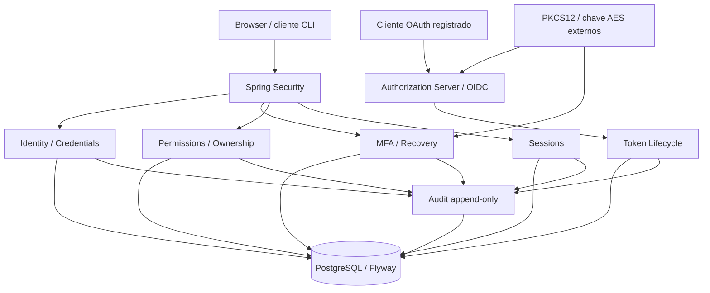
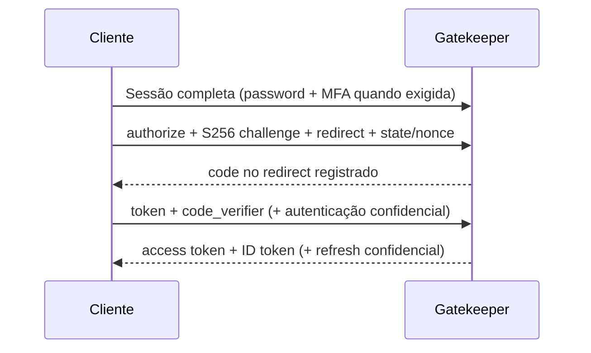

# Gatekeeper

Identity & Access Management platform built with Java and Spring, focused on standards-based authentication, authorization, session security, credential lifecycle and auditable security controls.

## Português (Brasil)

**v0.1.0-dev — Identity & Access Management Foundation.** Projeto de portfólio backend
que trata identidade, credenciais e autorização como fronteiras de segurança. Não é
uma certificação para produção. Repositório MIT; desenvolvimento na branch
`feature/iam-foundation`, PR para `dev`, sem merge, tag ou Release nesta missão.

O problema: implementar login é apenas uma parte de IAM. Gatekeeper conecta ciclo
de identidade, MFA, sessões, permissões, OAuth/OIDC, revogação, recuperação e auditoria
com invariantes no PostgreSQL e provas adversariais reproduzíveis.

### Arquitetura e fronteiras

Monólito modular Java 21 / Spring Boot 3.5.16 / Spring Security 6.5.11 / Spring
Authorization Server 1.5.8, JDBC, PostgreSQL 18.7, Flyway, Spring Session e Actuator.
Versões/fontes: [versions](docs/versions.md). Sem frontend ou infraestrutura de mensageria.



[Threat model](docs/threat-model.md), [arquitetura](docs/architecture.md) e
[security model](docs/security-model.md) descrevem assets, atores, fronteiras,
ameaça → controle → risco residual → evidência. Cliente não decide permissões.
Rotas sem política explícita são negadas; matriz em [authorization](docs/authorization.md).

### Autenticação, MFA e autorização

Identidade UUID opaca, login normalizado/único, ACTIVE/LOCKED/DISABLED. Passwords
Argon2id; passphrases 15–128 caracteres sem composição artificial. Respostas genéricas
e limites por conta/origem reduzem enumeração e guessing; não prometem resistência
perfeita a botnets. Sessão JDBC: HttpOnly, SameSite=Lax, Secure por padrão, rotação no
login e CSRF em mutações. [Authentication](docs/authentication.md), [sessions](docs/sessions.md).

TOTP RFC 6238 só ativa após prova de posse. Seeds AES-GCM; passo aceito não se reutiliza;
recovery codes aleatórios, hashed e single-use. MFA incompleta não recebe principal.
Roles agrupam permissões; ownership usa subject autenticado; recurso de outra pessoa
responde 404. [MFA](docs/mfa.md), [ADRs](docs/adr/).

### OAuth/OIDC e ciclo de tokens

Servidor oficial Spring: discovery/JWKS, Authorization Code com S256 obrigatório,
redirect exato, ID token e access JWT RS256 de 5 minutos com issuer/audience/kid.
Cliente público sem secret/refresh; cliente confidencial com secret hashed e refresh
rotativo de 30 minutos. Replay de refresh revoga família; exchanges concorrentes não
criam famílias válidas independentes. [OAuth/OIDC](docs/oauth-oidc.md), [tokens](docs/token-lifecycle.md).



Password reset usa token random hashed, expiração e consumo único atômico. Reset,
password change, mudanças de MFA e de estado revogam sessões/authorizations. Logout
revoga todas as credenciais da identidade. JWT externo validado offline continua até
expiração/skew; recurso local consulta revogação. [Recovery](docs/account-recovery.md).
Audit persistente rejeita UPDATE/DELETE/TRUNCATE, sem segredos. DBA privilegiado continua
uma fronteira de confiança. [Audit](docs/audit.md).

### Executar e verificar

Requisitos: JDK 21 (`JAVA_HOME`), Docker/Compose, Git e PowerShell 7. Linux: shell/OpenSSL.

```powershell
git clone https://github.com/GuiNovaisz/gatekeeper-java-iam.git
cd gatekeeper-java-iam
git switch feature/iam-foundation
./scripts/configure.ps1
docker compose up --build --wait --wait-timeout 180
Invoke-RestMethod http://127.0.0.1:8080/actuator/health/readiness
./mvnw.cmd -B -ntp clean verify
docker compose down
```

Linux: `sh scripts/configure.sh` e `sh mvnw -B -ntp clean verify`. Configure gera
credenciais únicas ignoradas pelo Git; leia `.env` privadamente para bootstrap e remova
bootstrap após trocar password. Nunca publique `.env` ou `docker compose config`.
Docker multi-stage, digests fixos, Java 21, usuário não-root, API loopback e volume DB.
Instruções completas para bootstrap, chaves, recovery, backup e shutdown: [operations](docs/operations.md).

Demo OAuth reproduzível: execute o teste
`IamSecurityIT#oidcDiscoveryJwksPkceAndCodeReplayAreRealProtocolFlows` com Failsafe;
o harness usa HTTP real, sem frontend ou callback listener. Suíte completa:
unit, PostgreSQL, security, protocol e concurrency. [Testing/matriz](docs/testing.md),
[evidências G1–G20](docs/evidence.md), [contrato OpenAPI](docs/openapi.yaml).
CI verifica build/testes/package, Docker/Compose/health, dependency review high e
scan de artefatos; credenciais efêmeras são mascaradas antes da exportação.

### Limitações e roadmap

Foundation local: sem hosted login UI, email real, prova de titularidade de email,
KMS, rotação de chaves com overlap implementada, retenção automática ou defesa
distribuída. Fake recovery é local/test e não expõe mailbox HTTP. Tokens OAuth no
store JDBC requerem proteção de DB/backups. Produção exige TLS, Secure cookies,
roles DB separadas, storage cifrado e delivery real. TOTP não resiste a phishing em
tempo real; privilégios DBA podem alterar o audit trigger. Nenhuma alegação absoluta.
Roadmap: hardening operacional, rotação controlada, outbox/delivery e WebAuthn após
revisão. Sem frontend/v0.2.0 nesta missão.

The complete English version follows below.

## English

**v0.1.0-dev — Identity & Access Management Foundation.** A backend portfolio project
treating identity, credentials and authorization as security boundaries. It is not
a production certification. MIT repository; development on `feature/iam-foundation`,
PR targeting `dev`, with no merge, tag or Release in this mission.

The problem: login is only one part of IAM. Gatekeeper connects identity lifecycle,
MFA, sessions, permissions, OAuth/OIDC, revocation, recovery and audit through real
PostgreSQL invariants and reproducible adversarial evidence.

### Architecture and boundaries

Java 21 modular monolith: Spring Boot 3.5.16, Spring Security 6.5.11, Spring
Authorization Server 1.5.8, JDBC, PostgreSQL 18.7, Flyway, Spring Session and Actuator.
Official sources/versions: [versions](docs/versions.md). No frontend or messaging infrastructure.
The architecture diagram above applies to the same implementation.

[Threat model](docs/threat-model.md), [architecture](docs/architecture.md), and
[security model](docs/security-model.md) describe assets, actors, boundaries and
threat → control → residual risk → evidence. Clients never decide permissions.
Unclassified routes are denied; [endpoint matrix](docs/authorization.md).

### Authentication, MFA and authorization

Opaque UUID identities, normalized unique login, ACTIVE/LOCKED/DISABLED. Argon2id
passwords, 15–128-character passphrases without arbitrary composition rules. Generic
responses and source/account limits reduce enumeration and guessing without claiming
complete botnet protection. JDBC sessions use HttpOnly, SameSite=Lax, Secure by
default, login rotation and CSRF on mutations. [Authentication](docs/authentication.md),
[sessions](docs/sessions.md).

RFC 6238 TOTP activates only after possession proof. AES-GCM seeds, monotonic accepted
timestep, random hashed single-use recovery codes. Incomplete MFA never gets an
authenticated principal. Roles group permissions; ownership uses authenticated subject,
and foreign private resources return 404. [MFA](docs/mfa.md), [ADRs](docs/adr/).

### OAuth/OIDC and token lifecycle

Official Spring server: discovery/JWKS, Authorization Code with mandatory S256,
exact redirects, ID tokens and five-minute RS256 access JWTs with issuer/audience/kid.
Public client has no secret or refresh token; confidential client has a hashed secret
and rotating 30-minute refresh tokens. Refresh replay revokes its family; concurrent
exchanges cannot fork valid independent families. [OAuth/OIDC](docs/oauth-oidc.md),
[token lifecycle](docs/token-lifecycle.md). The sequence above shows the same flow:
complete session → S256 authorization → registered redirect code → verifier exchange.

Password reset uses random hashed expiring tokens with atomic single consumption.
Reset, password change, MFA/security-state changes revoke sessions/authorizations;
logout revokes all identity credentials. Externally validated offline JWTs remain
valid until expiry/skew; the local resource additionally checks revocation.
[Account recovery](docs/account-recovery.md). Persistent audit rejects UPDATE/DELETE/
TRUNCATE and stores no secrets; privileged DB administrators remain trusted.
[Audit](docs/audit.md).

### Run and verify

Requirements: JDK 21 (`JAVA_HOME`), Docker/Compose, Git, PowerShell 7 on Windows;
shell/OpenSSL on Linux.

```powershell
git clone https://github.com/GuiNovaisz/gatekeeper-java-iam.git
cd gatekeeper-java-iam
git switch feature/iam-foundation
./scripts/configure.ps1
docker compose up --build --wait --wait-timeout 180
Invoke-RestMethod http://127.0.0.1:8080/actuator/health/readiness
./mvnw.cmd -B -ntp clean verify
docker compose down
```

Linux: `sh scripts/configure.sh` and `sh mvnw -B -ntp clean verify`. Configuration
generates unique Git-ignored credentials. Read `.env` privately for bootstrap; remove
bootstrap after password change. Never publish `.env` or rendered Compose configuration.
Docker uses multiple stages, pinned digests, Java 21, a non-root runtime, loopback API
binding and a persistent DB volume. [Operations](docs/operations.md) covers bootstrap,
key custody, recovery, backups and shutdown.

Reproducible OAuth demo: run
`IamSecurityIT#oidcDiscoveryJwksPkceAndCodeReplayAreRealProtocolFlows` through Failsafe.
The harness uses actual HTTP without a frontend/callback listener. The full suite
covers unit, PostgreSQL integration, security, protocol and concurrency tests.
[Testing/matrix](docs/testing.md), [G1–G20 evidence](docs/evidence.md),
[OpenAPI contract](docs/openapi.yaml). CI verifies compile/test/package, Docker/Compose/
health, high-severity dependency review and artifact scanning; ephemeral credentials
are masked before export.

### Limitations and roadmap

Local foundation: no hosted login UI, real email, email ownership proof, KMS,
implemented overlapping key rotation, automatic retention or distributed abuse defense.
Fake recovery is local/test only, with no HTTP mailbox. The OAuth JDBC store retains
bearer values and needs protected DB/backups. Production requires TLS, Secure cookies,
separate DB roles, encrypted storage and a real delivery provider. TOTP cannot stop
real-time phishing, and DB administrators can alter audit triggers. No absolute claims.
Roadmap: operational hardening, controlled rotation, outbox/delivery, then reviewed
WebAuthn. No frontend/v0.2.0 work is part of this mission.
