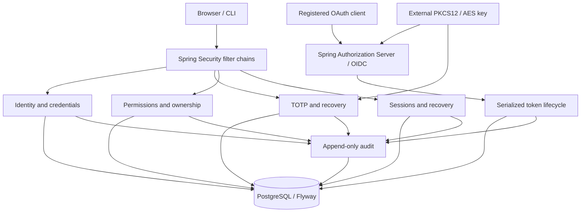

# Architecture

Modular monolith; Java 21; Spring Boot; Spring Security and its maintained Spring
Authorization Server integrated in Security 7.2; JDBC/PostgreSQL; Flyway. HTTP adapters delegate to
transactional application services; domain policies have no HTTP dependency.

Security chains separate protocol endpoints, bearer-only `/resource/**`, and
browser APIs. Cookie mutation endpoints keep CSRF. No CORS allowlist is enabled.
Unclassified routes are denied. Protocol logic is delegated to the Spring provider;
extensions enforce S256 and serialized refresh/code consumption, not a custom OAuth protocol.

Database is the consistency boundary; there is no Redis/message broker. Browser
sessions use Spring Session JDBC. API responses never return session bearer secrets.
