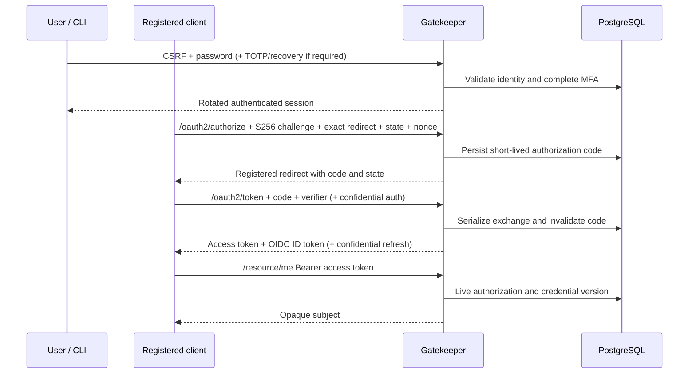

# OAuth 2.0 / OpenID Connect

Spring Authorization Server owns protocol parsing, code generation, PKCE verification,
token signing, discovery, JWKS, client authentication, revocation and OIDC ID tokens.
Gatekeeper configures policy and wraps official providers with DB transaction locks.
Not a custom OAuth implementation. The API harness performs real HTTP authorization
and token exchange; no central security provider is mocked.

| Client | Type/auth | Redirect | Grants | Scopes |
|---|---|---|---|---|
| gatekeeper-public | public / none; mandatory S256 | http://127.0.0.1:9090/callback | authorization_code | openid resource.read |
| gatekeeper-confidential | confidential / client_secret_basic; mandatory S256 | same exact URI | authorization_code refresh_token | openid resource.read |

No shared secret for public client. Confidential secret is at least 32 configured
characters (configuration scripts generate 256 random bits) and Argon2id-hashed.
No dynamic registration. Seed registration is idempotent and audited. Consent is
preapproved for these local first-party demo clients only, not general third-party
delegation. Adding clients requires reviewed provisioning code/migration; never
accept arbitrary client registration from users.

Discovery: `/.well-known/openid-configuration`; JWKS `/oauth2/jwks` exposes only public
parameters and kid. Code TTL 60 seconds, single exchange. Exact redirect includes
port; arbitrary loopback port relaxation is deliberately rejected. `plain` and
missing challenges are rejected. Token endpoint error details stay within standard
OAuth errors, with no stacktrace or credentials.

Demo: `./mvnw -B -ntp -Dit.test=IamSecurityIT#oidcDiscoveryJwksPkceAndCodeReplayAreRealProtocolFlows verify`
(Windows: `mvnw.cmd`). Testcontainers starts an independent server/database and
prints safe proof lines. Full suite adds adversarial PKCE, redirect, refresh and code races.
